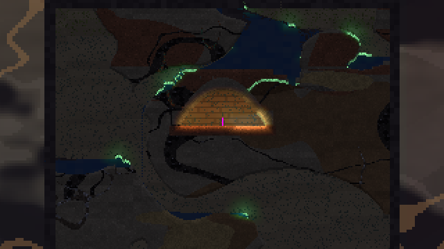
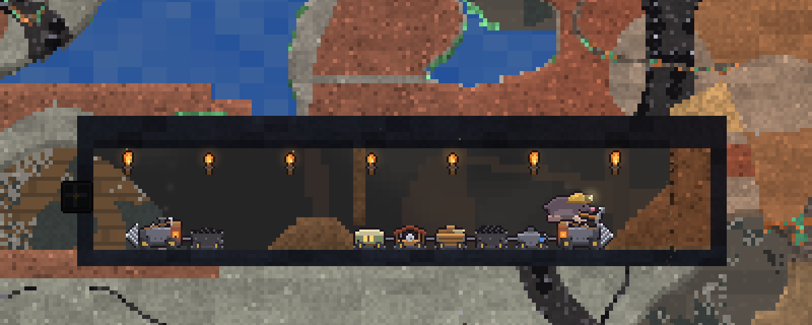

# Molehill

Molehill is a falling-sand platformer and colony sim about a mole digging through the Deepholt: earth that goes on in every direction, with no sky and no surface. Every cell is a material with weight and strength. Sand pours, water finds its level, lava creeps, and a roof cut too wide cracks and comes down. You dig a burrow, prop it up, light it and furnish it, then go further: down into harder, hotter rock, or sideways into other kinds of ground.

It is written in Rust with [Bevy](https://bevyengine.org/). This is an early development build (v0.1).





## Download

Get the latest build from **[Releases](https://github.com/wachtelhund/molehill/releases/latest)**:

| system | file |
|---|---|
| macOS | the macOS `.zip` (unzip, then open `Molehill.app`) |
| Windows | the Windows `.zip` (unzip, then run `molehill.exe`) |
| Linux (x86_64) | the Linux `.tar.gz` (extract, then run `./molehill`) |

The builds are not signed, so the first launch asks for confirmation:

* **macOS (Gatekeeper):** right-click `Molehill.app` and choose **Open**, then **Open** again. Or clear the quarantine flag in a terminal: `xattr -dr com.apple.quarantine Molehill.app`.
* **Windows (SmartScreen):** if "Windows protected your PC" appears, click **More info**, then **Run anyway**.

**In the browser:** the web build is in [`site/`](site/). Serve that folder with any static file server and open it, for example `python3 -m http.server -d site 8080` and then http://localhost:8080/. Add `?fresh` to the address to skip loading the autosave. The web build saves to the browser's local storage.

## How to play

The game opens on a main menu. **New Holt** asks for a mode and an optional seed:

* **Survival:** you start with a small kit. You dig with the tools you own, find food, burn fungus oil for light, and craft better tools at stations. When you die, your pack stays where you fell.
* **Creative:** every item, and nothing hurts.

| input | action |
|---|---|
| `A` / `D` | Run (`Shift` held: sprint) |
| `Space` (or `W`) | Jump: hold for a full jump, tap for a hop |
| `S` | Dig down |
| Left mouse | Use the item in hand: dig, build, place a torch, device or station, throw the rope gun's hook |
| Right mouse | Interact (levers, lifts, carts, wagons, lighting TNT); on an empty spot, set down the device in hand |
| `E` | Pick up the device, torch or copperline under the cursor |
| `Q` held, then released | Throw the item in hand |
| `W` / `S` by a rope, rope ladder or lift | Grab on and climb, or ride the lift between stops |
| `[` / `]` or `Alt`+wheel | Brush size for the tool or block in hand |
| `X` | Grid snap for blocks |
| `1`–`0`, wheel | Hotbar slot |
| `I` | Pack and crafting |
| `+` / `-`, `Ctrl`+wheel | Zoom |
| `G` | Headlamp on / off |
| `J` | Journal |
| `V` | Wiring view |
| `H` | Controls overlay |
| `Esc` | Pause menu |
| `K` / `L` | Quick save / quick load |

There is no wall climbing. You roll onto a ledge within reach; a higher one needs a rope ladder or the rope gun. The full list is on the wiki's [Player and Controls](docs/wiki/Player-and-Controls.md) page.

## Build from source

You need a stable Rust toolchain ([rustup](https://rustup.rs/)). On Linux you also need the usual Bevy system libraries, for example on Debian or Ubuntu: `sudo apt install g++ pkg-config libx11-dev libasound2-dev libudev-dev libxkbcommon-x11-0 libwayland-dev libxkbcommon-dev` (see Bevy's [Linux dependencies](https://github.com/bevyengine/bevy/blob/main/docs/linux_dependencies.md)).

```bash
cd engine
cargo run --release              # add `-- --fresh` to skip loading the autosave
```

`cargo run --release -- --seed=N` opens straight into the holt for that seed.

**Web build:** needs the `wasm32-unknown-unknown` target and `wasm-bindgen-cli` 0.2.130.

```bash
rustup target add wasm32-unknown-unknown
cargo install wasm-bindgen-cli --version 0.2.130
cd engine && ./build-web.sh      # writes ../dist/
```

**Tests:** all the game rules live in the `molehill-sim` crate, which has no graphics, so they run headless:

```bash
cd engine
cargo test --release -p molehill-sim
cargo run --release -p molehill-sim --example scenario -- sim/tests/scenarios/*.scn
```

See [TESTING.md](TESTING.md) for the scenario format and the benchmarks.

## Repository layout

| path | what |
|---|---|
| `engine/sim` | `molehill-sim`: the whole simulation in plain Rust (falling sand and fluids, structural stress, world generation, light, devices, crafting, saves) |
| `engine/game` | `molehill`: the Bevy front-end (input, rendering, sprites, HUD, menus, sound and music) |
| `engine/tools/cave-editor` | a developer tool for editing the found places' layouts; not part of the game |
| `site/` | a prebuilt copy of the web build |
| `docs/wiki/` | the wiki: how every system works, with the numbers ([start here](docs/wiki/README.md)) |
| `legacy/` | the earlier TypeScript prototype |

[LORE.md](LORE.md) describes the world's setting and the rules the game keeps to. [PROGRESSION.md](PROGRESSION.md) is the design for the longer progression.

## License

MIT. See [LICENSE](LICENSE).
