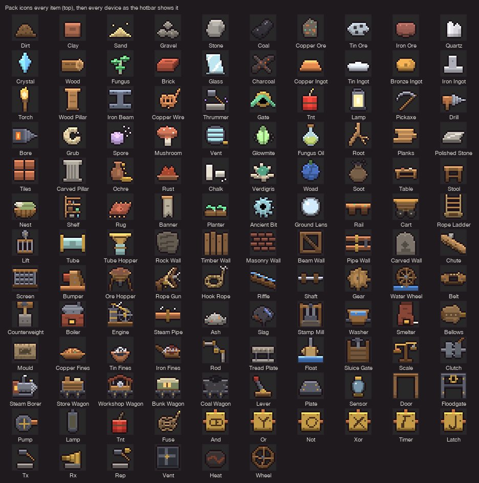
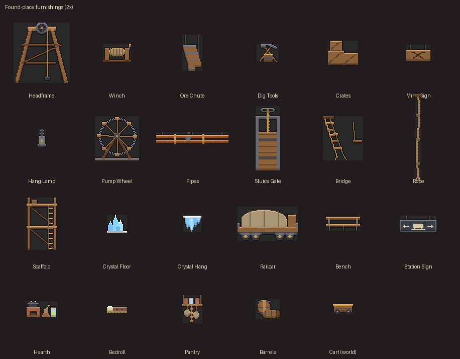

# Item and Place Art

> Code: `engine/game/src/itemart.rs` (pack icons), `devart.rs` (devices and copperline), `decorart.rs` (furniture, Lid clues), `props.rs` (found-place furnishings), `art.rs` (tools, the mole, the cart, chests, stations, rail and ore cells).

Every item has its own drawing. No two share a silhouette, and none is another item's shape in a different colour. Everything is hand-placed pixel art at 16 px to the metre (one 0.25 m tile is 4 px), outlined dark and lit from above, so it reads at any zoom with nearest sampling. The look is handmade: timber, stone, copper, brass and iron, with no glow except from things that burn or are alive.

## Pack icons

The pack, the hotbar, the item in the mole's paws and anything lying loose all use the icon (a loose item is drawn at half size). Devices in the hotbar use their own in-world sprite (`devart::hotbar_icon`, switched off), so a lever, a plate and a floodgate no longer share one placeholder. The fuse and the pressure plate are the exceptions: in the world each is a thin strip along the floor of its block, so the hotbar shows a coil of fuse cord and the plate seen from above at an angle.

| item | pack icon | in the world |
|---|---|---|
| Dirt | a crumbly heap with clods rolling off | lies loose as its icon |
| Clay | a squared wet block with a thumb dent and a cut face | lies loose as its icon |
| Sand | a low wide cone of grains | lies loose as its icon |
| Gravel | three separate pebbles | lies loose as its icon |
| Stone | an angular faceted block | lies loose as its icon |
| Coal | two glossy black lumps, one on the other | lies loose as its icon |
| Copper ore | a tall pentagon of rock with copper and green verdigris | lies loose as its icon |
| Tin ore | a wide pale chunk with dark square cassiterite grains | lies loose as its icon |
| Iron ore | a rust-red kidney lump with round bumps | lies loose as its icon |
| Quartz | two hexagonal prisms rising from a base | lies loose as its icon |
| Crystal | one tall blue bipyramid | lies loose as its icon |
| Wood | a log on its side, end grain showing | lies loose as its icon |
| Fungus | a cluster of three luminous shelf caps on a stalk | lies loose as its icon |
| Brick | one fired brick in perspective with a frog | placed cells of its material |
| Glass | a pane leaning, with a sheen across it | placed cells of its material |
| Charcoal | two charred sticks crossed, cracked across their grain | lies loose as its icon |
| Copper ingot | the classic trapezoid | lies loose as its icon |
| Tin ingot | a low pig with rounded ends | lies loose as its icon |
| Bronze ingot | a round bun cast in a dish | lies loose as its icon |
| Iron ingot | two bars stacked crosswise | lies loose as its icon |
| Torch | a wrapped stick with a flame | torch flame on a wall or floor |
| Wood pillar | a squared post with a cap and a foot | placed cells of its material |
| Iron beam | an I-section seen end-on, the web running back | placed cells of its material |
| Copperline | a coil of copperline with a loose end | copperline tile |
| Thrummer | a stone anvil with the knocking hammer raised | thrummer device (knocking stone) |
| Knot | a knot: a loop of copper cord tied through a brass ring | knot plate device |
| TNT | three bound charges with a lit fuse | charge device, blinking when lit |
| Lamp | a hooded lantern with a ring handle and glass | lamp device |
| Pickaxe | curved stone head on a haft | held in the paws (held sprite); loose as its icon |
| Drill | copper body, crank and fluted cone | held in the paws (held sprite); loose as its icon |
| Bore | iron housing, heat coil and cone | held in the paws (held sprite); loose as its icon |
| Grub | a curled, segmented larva | lies loose as its icon |
| Spore | a puffball shedding a drift of spores | mushroom plot when planted |
| Mushroom | a red cap on a pale stem, with spots | mushroom plot when planted |
| Vent | a round louvred grille with a crank | vent device |
| Glowmite | a pale-green glowing beetle with its legs out | lies loose as its icon |
| Fungus oil | a stoppered flask of greenish oil | lies loose as its icon |
| Root | a forked, hairy root | lies loose as its icon |
| Planks | three boards stacked, ends staggered | placed cells of its material |
| Polished stone | a thin dressed slab with a long gleam | placed cells of its material |
| Tiles | four fired tiles laid with gaps | placed cells of its material |
| Carved pillar | a fluted column with a capital and a base | placed cells of its material |
| Ochre | a narrow-necked clay jar, yellow earth spilling from its lip | lies loose as its icon |
| Rust | red flakes heaped in a shallow dish | lies loose as its icon |
| Chalk | two sticks of chalk, one snapped | lies loose as its icon |
| Verdigris | a scallop shell with green crust scraped into it | lies loose as its icon |
| Woad | a dried woad ball, leaves pressed round | lies loose as its icon |
| Soot | a drawstring pouch, black dust at its mouth | lies loose as its icon |
| Table | its furniture sprite, scaled | furniture sprite |
| Stool | its furniture sprite, scaled | furniture sprite |
| Nest | a woven basket bed heaped with a blanket and a pillow | furniture sprite (cloth takes pigment) |
| Shelf | its furniture sprite, scaled | furniture sprite |
| Rug | a rug laid flat in perspective: a diamond worked in, fringe at both ends | furniture sprite (cloth takes pigment) |
| Banner | its furniture sprite, scaled | furniture sprite (cloth takes pigment) |
| Fungus planter | its furniture sprite, scaled | furniture sprite |
| Ancient bit | a toothed ring of an unknown metal, too true to be hand-cut | lies loose as its icon |
| Ground lens | a thick round lens in a dull ring, two glints | lies loose as its icon |
| Rail | a length of copper strap on two sleepers, side on | placed cells of its material |
| Mine cart | a plank tub with a bronze rim on two wheels | cart sprite on the rails |
| Rope ladder | ropes and rungs, rolled at the bottom | rope ladder (ropes and rungs) |
| Rope gun | a root-wood stock with a brass crank and a stone hook in the muzzle (placeholder) | held (icon) |
| Hook rope | a coil of rope with a stone hook on top (placeholder) | rope chain and hook |
| Lift | a cage hung from a sheave | lift head frame, rope and cage |
| Pressure tube | a pressure-tube length with flanged ends | placed cells of its material |
| Tube hopper | a brass funnel mouth on a stub of tube | brass hopper mouth |
| Chute | a timber trough running downhill, a lump sliding down it | placed cells: a pale worn lip on top, boards with a dark seam every half metre |
| Shaker screen | an iron grating in a timber frame, the mesh open between the bars | placed cells: a timber top rail, iron bars every half metre, the dark mesh between |
| Bumper | a squat timber buffer with a red pad, standing on a rail end | placed cells: red-painted timber, a brighter worn head, an iron band and bolt every metre |
| Ore hopper | a timber bin heaped with ore, tapering to a spout, on splayed legs | ore hopper sprite: back boards, the heap tinted with what it holds, the front frame open over the heap, a boarded taper to an iron spout whose gate shows shut or swung open, two legs down to the floor (`art::ore_bin`) |
| Rock wall | a rough slab of scraped host rock with tool marks | background lining |
| Timber wall | boards standing on end, uneven tops, gaps between | background lining |
| Masonry wall | laid courses with the joints staggered, a stepped edge | background lining |
| Beam wall | a timber frame with a cross brace | background lining |
| Pipe wall | two pipes on a bracket, a joint on each | background lining |
| Carved wall | an arched panel with a carved mole's mark | background lining |

**Devices** (21) each have one sprite, shown both in the world and in the hotbar: lever, pressure plate, fluid sensor, door, floodgate (iron, braced across while shut, with the hand-wheel that winds it), pump, lamp, TNT, fuse, the six knots (each a brass plate with its own mark), thrummer, listener, relay thrummer, vent, heatstone and water wheel. In the wiring view each also has a schematic glyph (`devart::s_device`).

**Other world sprites:** the mole (13 poses, lamp on and off), the held tools and blocks, the torch flame (two frames), chests (shut and open, plain and Ancient), the four stations (built and as a ghost), mushroom plots (three growth stages), Lid clues (two carvings, a note, six odd finds) and the mine cart (`art::cart`).

**Still missing:** nothing has placeholder art. Loose items reuse their pack icon instead of a separate lying-down sprite. Glowmites in a grotto are drawn as moving points of light, not as the beetle.

## Found-place furnishings

Found places are furnished with props (19 kinds), which are drawn only: they are not cells, have no weight and can't be dug or picked up (`props.rs`). The set-pieces a layout already builds in cells (the mine's headframe and ore chute, the pumpworks' wheel, the fossil dig's scaffold) are not drawn again. Each family has a list of what goes where, in metres from the site's corner. Each prop is then fitted against the cells actually there:

* a standing prop needs both feet on something solid, or one foot down and the other against a post or wall;
* a hanging one needs a roof over most of its width;
* nothing may overlap rock, furniture, a chest, a farm, a ladder or another prop.

A prop that finds no room within its slide distance is left out. Lamps are cold: nobody has filled them, and they give no light.

| place | furnishings |
|---|---|
| Abandoned mine | a rope winch on the heading by the shaft, scaffolding at the worked face, dig tools (pick, shovel, bucket), stacked crates, a mine sign with crossed picks, four cold lamps. Its headframe, sheave and ore chute are built in cells by the layout |
| Abandoned holt | a kitchen on the table (clay stove and pot, bowls, a jar, a pestle), a bedroll on the bedding, a hanging pantry (jars on a board, sacks, dried mushrooms on a string), three cold lamps. Its nests, rugs, table, stools, shelf, banner and planters are furniture |
| Flooded pumpworks | two runs of copper pipe under the roof, a sluice gate with its screw and hand-wheel over the intake, barrels, two cold lamps. Its pump wheel is built in cells |
| Fissure | three broken bridge stubs hanging off the ledges, two knotted ropes from the top |
| Fossil cave | dig tools on the floor by the bones, crates by a mouth, two cold lamps. Its scaffold is built in cells |
| Salt / crystal hall | three standing crystal clusters, three hanging ones |
| Buried cargo halt | a flatbed railcar under canvas on the rails, a waiting bench, a hanging station sign (a cart and arrows, no words), barrels and crates in the warehouse, two cold lamps |

The game places them once per window and redraws them each frame. Like furniture, they are lit by the cells around them and show once their spot has been seen.

## Checks

Game-crate tests (`cargo test --release -p molehill`):

* `every_item_has_its_own_icon`: every icon has at least 40 px and four colours. For every pair of icons, at least 20 pixels differ in coverage or brightness band (judged against each icon's own range, so a tint scores 0), and at least 8 differ in silhouette.
* `every_slot_icon_fills_its_slot`: every pack icon and device hotbar icon covers at least 80 of its 256 pixels. The nest (its 9 × 3-tile sprite scaled), the fuse and the plate were slivers of 64–74 px; the median icon covers 135.
* `every_device_has_its_own_sprite`: the same pattern check for the 21 devices.
* `every_prop_has_its_own_sprite`: every prop is mostly filled, has at least four colours and differs from the others.
* `production_blocks_have_their_own_look`: the chute, shaker screen and bumper patterns differ from each other by at least 30 in mean colour. The screen is at least 40% dark mesh with bright bars, the chute's top is a pale lip, and the bumper's head is red.
* `ore_hopper_is_a_drawn_bin`: the bin's back boards fill it, the front leaves the upper part open (so the heap shows), the taper is boarded down to a spout, the open gate differs from the shut one, and the heap sprite is pale so its tint gives the ore colour.
* `found_places_are_furnished`: each family is stamped into rock and must get its listed furnishings, all inside the site and none in rock. Every prop kind is placed somewhere.

`--dump-art=DIR` writes every icon (`sprite-icon-*`), device (`sprite-dev-*`), prop (`sprite-prop-*`), the cart and the rest at 8×. Its `view.bmp` now composites every visible world sprite (furniture, props, chests, torches, carts, the mole) over the cells, so stills show the furnishings; `view_cells.bmp` is the cells alone. The stills under [World and Generation](World-and-Generation.md#what-they-look-like) are these composites.
