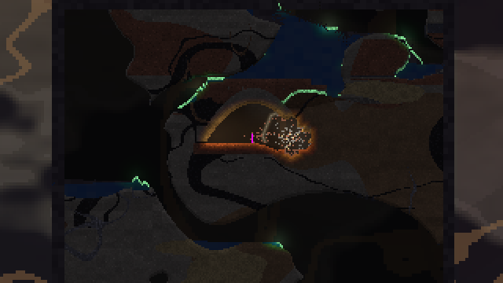

# Physics

> Code: `mat.rs` (material table), `grid.rs` (falling sand and fluids), `stress.rs` (structure), `light.rs`, `air.rs`, `logic.rs` (thrumming).

Molehill's design rule is that **nothing happens by decree**. Collapse, flooding and signal reach all come out of a few physical models that share one material table. When the game feels wrong, the fix goes into a model or a number in that table, not into a special case.

## Units

| quantity | unit |
|---|---|
| cell edge `s` | 0.125 m (1 m = 8 cells, `mat::CPM`); depth into the screen `b` = 1 m |
| tile | 0.25 m = 2 × 2 cells: the size everything was first tuned at. Lengths below given in *tiles* scale with `mat::S` (cells per tile), so behaviour is the same in metres at any resolution |
| time | 60 ticks per second, fixed |
| density ρ | kg/m³ |
| strength, stress, pressure | kPa |
| `g` | 9.81 m/s² |

## Materials

Every cell holds one of 36 materials. Each has a **kind**, which picks how the falling-sand automaton treats it:

| kind | materials | behaviour |
|---|---|---|
| Solid | bedrock, granite, rock, limestone, basalt, dirt, clay, gravel, coal and ores, quartz, crystal, roots, grass, moss, mycelium, root-tree and its roots, glass, wood beam, stone brick, iron beam, door, and the decorative planks, polished stone, tiles and carved pillar | Static until it cracks or is knocked **loose**; loose solids fall like powder |
| Powder | sand, fungus | Always fall and slide by angle of repose |
| Liquid | water, lava | Fall, then spread sideways to level out |
| Gas | steam, fire | Rise and fade |

Strengths are **rock-mass** values: lab values for intact rock scaled down (about ×0.02–0.05) for joints and flaws, as rock mechanics does with GSI and Hoek-Brown. A selection:

| material | ρ (kg/m³) | tensile (kPa) | compressive (kPa) | tool tier | breaks into |
|---|---|---|---|---|---|
| dirt | 1600 | 15 | 250 | claws | dirt |
| clay | 1800 | 40 | 400 | claws | clay |
| sand | 1600 | 0 | 150 | claws | (powder) |
| limestone | 2500 | 400 | 9000 | pickaxe | gravel |
| soft rock | 2300 | 300 | 8000 | pickaxe | sand |
| basalt | 2900 | 700 | 18000 | drill | gravel |
| granite | 2700 | 800 | 20000 | drill | gravel |
| crystal | 2600 | 300 | 20000 | drill | gravel |
| wood beam | 600 | 3000 | 8000 | claws | wood splinters |
| stone brick | 2400 | 600 | 15000 | pickaxe | gravel |
| iron beam | 7800 | 40000 | 120000 | drill | iron debris |
| water | 1000 | – | – | – | – |
| lava | 2700 | – | – | – | – |

Each material also carries a dig time, a blast resistance, a light emission and opacity, a colour, and a **repose** value (0 flows freely, 1 never slides). Dirt is 0.15, clay 0.45 and gravel 0.4.

The rest of a material's behaviour is in the same row (`Props` in `mat.rs`), and the rules read it rather than naming materials:

* **Heat.** `heat` is what it gives off (a flame 1, lava 2): it burns a mole, feeds the air's fire load and lights fuses. `ignite` is the heat needed to set it alight: wood, roots, fungus and doors catch from any flame; coal only from lava. `cools_to` is what it sets into when it loses heat: lava becomes basalt (shattered scoria when water quenches it), and a flame touching water becomes steam.
* **Flow.** Liquids carry `spread` (how far a cell runs along a surface per tick, in 0.25 m tiles: water 6, lava 2) and `flow_in_10` (on how many ticks in 10 it moves: water 10, lava 3). `life` is how long steam and fire last.
* **Loose items.** `bounce` (how much of a landing's speed bounces back) and `friction` (how hard the surface grabs a sliding item) are per material: granite 0.35/0.5, dirt 0.05/0.9, iron beam 0.45/0.35. An item floats or sinks by comparing its density (its material's, see `Item::density`) with the liquid's, and drags more in lava than in water (`flow_in_10`).
* **Thrum conduction** is derived from density and compressive strength (see Thrumming below).
* **Flags** sort materials for the few rules that need a category: `SOIL` (a mushroom plot can grow on it), `POROUS` (lets stale air seep away), `GRUBS` (digging turns up grubs), `BUILT` (placed by moles: breaks into its own debris, never bulks, a quake doesn't loosen it), `NOTABLE` (a discovery note the first time it's seen) and `OPEN` (a placed block displaces it).

A new or retuned material is a single row edit. `material_table_is_consistent` checks that the rows hang together.

## Falling sand

The grid is a Noita-style cellular automaton on **64 × 64-cell chunks** (8 m):

* Chunks update in **four checkerboard phases**. Chunks in the same phase are at least 64 cells apart, and no cell moves more than 6·S cells a tick, so a phase can run in parallel (rayon on native) and still be deterministic. Randomness is a hash of `(x, y, tick)`, never a shared stream.
* Rows run bottom-up, alternating left-right and right-left each tick to avoid drift.
* **Sleeping chunks.** A chunk only updates while something in it can move. A grain with nowhere to slide, a pool with a level surface or lava with no real move all rest without waking their chunk. A settled world runs at about 0 awake chunks (`wakediag` checks this), and a settled tick costs about 0.13 ms.

**Grains** (powder, or solid cells flagged loose) fall into empty space or gas, then try the two lower diagonals. A grain **sinks through a lighter liquid** (sand, gravel and scoria through water, more slowly than falling) and **floats on a denser one** (sand on lava). Light debris such as wood splinters bobs up through water and floats.

## Liquids and lava

* A liquid falls first, then tries the lower diagonals.
* **Active region:** the automaton only runs within 64 m sideways and 48 m vertically of the mole (wider than the view at the widest zoom). Chunks outside keep their wake flag and carry on exactly where they stopped once the region reaches them.
* **Free fall** is up to S cells (one tile) a tick for grains and liquids, so things fall as fast in metres at any resolution.
* **Sideways flow is purposeful.** A surface cell looks up to 48 cells (6 m) along its row for a lower spot and moves toward it (water up to 6 tiles a tick, lava 2). It also spreads when liquid presses on it from above, so a heap levels out. Otherwise it stays put, so a pool with a part-filled top row doesn't slosh forever.
* **Lava is viscous:** it only moves on about 30 % of ticks. Flowing lava sets wood, roots, fungus, coal and doors on fire. Lava that has come to rest sleeps with its chunk, so it doesn't set fire to wood beside it.
* **Thin lava cools.** Every 30 ticks a quarter of the rows is swept, each lava cell there with a 1-in-6 chance to be checked (the same rate as 1-in-24 for every row). If it has fewer than 10 tiles' worth of lava in its 1.25 m (5 × 5-tile) neighbourhood and rests on solid ground, it freezes into basalt. A splash sets in about 10–20 s, and a spreading sheet crusts from its thin front. Deep pools keep their heat, and only their thin edges crust. Lava never freezes on top of molten lava, because a crust there would just break up again (`lava_cools`).
* **Lava meeting water** quenches: the lava cell becomes loose basalt **scoria** that sinks, and the water becomes **steam**. Steam drifts up, fades after about 1.5 s and sometimes condenses back into a drop of water.
* **Fire** spreads to wood, roots, fungus and doors, rises, burns out, and turns to steam on touching water.
* **For the mole,** water is swimmable and lava is a thick, burning liquid. You sink into it, wade at a quarter speed and burn at 75 hp/s (see [Player and Controls](Player-and-Controls.md#water-and-lava)).

## Structure and stability

The structural solver (`stress.rs`) is the heart of the game. A full solve covers the whole window (2 M cells, about 40 ms on native), so after the first one the world re-solves **locally**: every structural change (a cell set, a grain slipping out from under rock, a fire or quench) flags its 8 m chunk; flagged chunks cluster, and each cluster is solved in a region (the cluster plus 32 m to the sides, the 16 m arch height above and 8 m below; roof rows and runs reach past it exactly) and written back for the cluster plus 4 m. Clusters go nearest the mole first, about an eighth of the window per pass; the rest wait 6 ticks. A local re-solve matches a full one (`local_stress_resolve_matches_full_solve`). It runs after structural edits (every 6 ticks while anything is dirty) and after fire and lava reactions (every 24 ticks).

### 1. Overburden

The pressure on a cell is the weight of the column above it:

```
P(x, y) = Σ ρ · g · s / 1000   [kPa]   over non-empty cells in the 16 m above
```

Only 16 m counts. That is the **pressure-arch height** (Terzaghi arching): load from deeper overhead flows around an opening through the ground arch.

### 2. Load path

A breadth-first search starts from bedrock and from the window's top and bottom rows (the Deepholt continues past them). **Static cells carry each other in all four directions.** **Loose ground** (sand, rubble) carries only what rests directly on it, so a pillar built on a sand floor still has a load path down to rock. A static cell that isn't reached has no load path; it gives way after **8 ticks**, and its debris sinks or floats by density.

### 3. Roofs in bending

Every horizontal run of static cells with nothing supporting it from below is treated as a **beam**:

* span `L = n · s`;
* depth `h` = the static thickness above it, **capped at about one span** (the Voussoir effect: only about L of rock acts as the beam, and the rest arches);
* `q` = superimposed load from **loose material lying directly on it** (rubble, sand or water). Static rock above the cap carries itself, and a cave above is carried by its own roof.

```
M  = k · (ρ g h + q) · L²      k = 1/8 if both ends rest on support, 1/2 for a cantilever
Z  = b · h² / 6
σt = M / Z                     compared with the weakest tensile strength along the run
```

The moment isn't spread evenly: it follows `x(L − x)` for a beam resting at both ends (peaking at midspan) and the distance from the free tip squared for a cantilever. An overloaded roof therefore **breaks where the moment peaks**, an arch forms, and the cave-in stops. It doesn't peel the room row by row. In a test, an over-wide 15 m hall went from 840 crumbled cells to 12 after this change.

Examples from the tests: a 1 m span of 1 m-thick dirt holds and a 6 m span fails; a 12 m rock roof caves in, but two pillars at its third points save it.

### 4. Pillars and walls in compression

Every horizontal run of static cells of width `w` carries its own overburden plus half of the load over the open space on each side (**tributary area**):

```
σc = (Σrun P + ½ Σleft void P + ½ Σright void P) / w
```

Two refinements keep this honest:

* **Tributary load needs contact.** A run only takes load from a void if its own static column reaches that void's roof. A half-built pillar or a floor bump carries only what rests on it. The load from beside an opening is capped at its loosened zone, about the opening's width in rock, so a lone prop in a sound hall isn't crushed.
* **Confinement.** Only the cells at a run's free faces see their full unconfined strength. Cells held in on both sides are judged at half the stress (Mohr-Coulomb with σ3 ≈ K0·σv), so an overloaded body **spalls at its faces** instead of turning to rubble all at once.

### 5. Cracking and crumbling

Utilisation is `u = σ / strength`. When `u > 1` the cell **cracks** visibly and a **40-tick** countdown starts. If the load is relieved in time, for example by building a pillar or digging less, the crack heals. Otherwise the cell crumbles into its loose form (dirt, gravel, sand, or splinters of its own material for wood and iron) and joins the falling sand. That debris can load the next roof, so failures can cascade.

**Broken ground bulks.** Rubble takes more room than the solid it came from: 3 in 10 crumbling cells of natural ground leave an extra cell of rubble. It spills to the nearest open cell reachable from the break through loose ground, level with the break or lower, searching up to 48 tiles (12 m). It never passes through rock, so rubble can't appear in a sealed room. A cave-in therefore fills its own void and chokes off instead of chimneying up through a whole dirt layer: a 10 × 4 void under 30 rows of dirt rises about 7 rows and stops (`dirt_cavein_chokes`). Built blocks (wood, iron, doors, brick, glass) don't bulk.

```
 dig wide ─▶ beam σt > tensile ─▶ crack (40 ticks) ─▶ crumble ─▶ debris loads the roof below ─▶ …
                     ▲                    │
                     └── prop it in time ◀┘  (crack heals)
```

### Building that holds

Placed blocks are judged by the same rules, which is the point: you learn to build the way the rock does.

* **Wood pillars** are light and strong in compression (8000 kPa): prop a dirt or clay roof every metre or two.
* **Decorative blocks** hold by their own numbers: planks 6000 kPa (light, like wood), polished stone 15000 kPa (like brick), tiles 9000 kPa but weak in tension, and carved pillars 22000 kPa, the strongest stone prop (scenario `decor_blocks`).
* **Iron beams** have about 13 times the tensile strength of wood: they bridge wide gaps and carry heavy roofs.
* **Stone brick** is strong in a wall but heavy on a roof.
* Everything you place must touch something solid, so a stroke grows out of what it rests on. See [Tools and Items](Tools-and-Items.md#the-round-brush).
* **Background walls** are not in this table. They are a separate byte per cell, never a material, so they never collide, never carry load, and never move with falling sand. A timbered room with no props still comes down (`wall_no_support`). See [World and Generation](World-and-Generation.md#background-walls).

### Known limits

* There's no liquid pressure. Water in a tall column doesn't push through a U-bend under a wall; it spreads sideways only when pressed from directly above. This is parked until after the cell resize.
* Thin roofs are judged by their bottom fibre only: a one-cell clay skin under granite limits the whole roof.
* Resting lava never ignites wood beside it.
* A resting pool can keep a 1-cell step if the lower spot is more than 6 m away.
* Overburden still passes through caves higher up, which can crush a dirt seam under deep rock whatever supports it.

## Blasts

A blast (`blast.rs`) is a pressure wave, not a fixed crater. A TNT charge is **0.5 kg** of TNT.

* **The wave** runs out from the charge through open air, gas and liquid, shortest path first. Solids stop it. Its peak overpressure follows the **Kinney-Graham** free-air curve, P(Z) with Z = R / W^⅓, except that R is the *equivalent radius of the volume the wave has already filled*: R = (3V / 4π)^⅓.
  * A tunnel fills slowly, so the pressure holds along it. A cave fills fast and soaks the wave up. 5 m from a charge it's about 370 kPa down a 0.75 m tunnel and 80 kPa across a 6 m cave (`blast_tunnel_vs_cave`).
  * Water barely yields, so a cell of water counts as a fifth of a cell of air.
  * In a closed space the hot gas also pushes: P = max(shock, 0.35 × 4184 kJ/kg × W / V). A charge tamped into a tight pocket therefore breaks more than one in the open.
* **Shadows.** The wave loses pressure bending round edges. It's divided by 1 + detour / 0.5 m, where the detour is how much longer its path is than the straight line. A straight tunnel loses nothing, while a mole behind a wall is barely touched (`blast_shadow`).
* **Breaking rock.** Every solid face the wave reaches is loaded with the overpressure there. A material's blast strength comes from the material table's blast resistance (`BLAST_KPA`):

  | material | sand | dirt, gravel, roots | clay, wood beam | coal | sandstone, limestone, copper and tin ore | iron ore, crystal, stone brick | quartz | granite | basalt | iron beam | bedrock |
  |---|---|---|---|---|---|---|---|---|---|---|---|
  | strength (kPa) | 60 | 150 | 220 | 300 | 360 | 700 | 850 | 1000 | 6500 | 9000 | never |

  Above its strength a face **cracks** into loose rubble; above 2.5× it **shatters** away, and a third of what shatters flies as rubble.
  * **Confinement** is the rock the wave hit or broke per open cell it filled: about 0.1 in a cave, 0.3 in a tunnel, near 1 in a tamped pocket. A boxed-in charge's gas keeps pushing, so the load on every face is raised by (1 + confinement).
  * The load then runs on **into** the rock, radially away from the charge, fading as e^(−d/λ) and cracking and shattering what it still beats. λ = 0.8 m × (1 + 2·confinement). Because it runs radially, a tamped charge breaks a round crater, not a cross.
  * What one 0.5 kg charge breaks in soft rock:
    * On a tunnel floor, a crater through the 1 m floor to bedrock and 1.25 m into the roof, broken in patches out to 2.5 m along the tunnel. Rock 3.5 m off stays whole. About 155 tiles break, and the rubble is thrown metres along the tunnel (`blast_soft_rock_tunnel`).
    * Tamped into a 0.5 m pocket, a round crater about 5 m across: about 250 tiles (`blast_pocket`).
    * On a 6.5 m cave's floor, about 38 tiles (`blast_cave_soaks`).
  * Granite is much tougher than soft rock but still gives way. On a tunnel floor one charge blasts it 0.75 m down and 0.5 m up into the roof: about 60 tiles broken and thrown as gravel (`blast_granite_chips`). Tamped into a pocket, about 160 tiles, a crater a couple of metres across (`blast_granite_pocket`). Basalt loses only the face it sits on, a few tiles (`blast_basalt_holds`). Dirt goes readily (`blast_granite_vs_dirt`).
* **Throwing.** Loose ground (sand, gravel, rubble, ash), the rubble the blast cracks and liquids in the wave really fly (`debris.rs`).
  * The push on a loose face runs on into the bed or pile, fading over 0.8 m; anything still pushed by 8 kPa or more goes.
  * Each cell leaves the grid as debris at about 1 m/s per 7 kPa, at most 30 m/s. Cracked rubble goes at 0.9 of that, liquids at 0.8.
  * It flies away from the charge with a little spread. Ground backed by rock (a sand floor, a pool's bed) can't be driven into the rock, so it's thrown back out of its surface: a floor sprays up and out.
  * In flight it falls under gravity with a little air drag, slides along a floor it lands on, and settles as a cell in the last open cell before what it hits. A cell buried by the heap it fell into comes out at the nearest open cell (above first, out to 3 m). Nothing is lost, and water splashes down and flows on. A charge a metre from a sand bed has a third of it in the air at once (`blast_moves_sand`). A flooded trough goes up in a plume of spray (`blast_pushes_water`).
  * Everything is deterministic (the spread comes from a cell hash), and at most 12,000 cells fly at once.
* **Items** fly along the wave, harder the higher the pressure.
* **Moles** take (P − 40 kPa) / 3 damage from the overpressure where they stand: a knock under 40 kPa, deadly at about 340. The player is also knocked along the wave.
* **Feel.** The bang comes with a quake event and a crumble when rock breaks, and the screen shakes by the charge size and by the pressure at the player.
* **Heard once.** One charge is one blast, and its bang and jolt are heard once. Afterwards the cracked faces round the crater go on shedding the odd cell for a few seconds. That falls silently: only a collapse of at least two tiles' worth of cells in a tick sounds the collapse rumble (`CRUMBLE_LOUD`), and a new stress crack gives its short click as ever (`blast_events` tests; the `blastevents` example logs what one charge sets off, second by second).
* **Seeing the wave.** The wave has no outline. It shows through what it carries: the debris it throws, and a light dust.
  * Each blast keeps a record of its wave: every cell the pressure reached, the path distance the front ran to get there, its peak and its direction (`World::waves`).
  * The game raises sparse dust, the colour of the rock it was knocked off, along that path as the front passes (slowed to 22 m/s so it can be followed). It rides out with the wave down the tunnels and round corners, then slows and settles. A small puff of smoke rises from the charge. Flying debris is drawn as it moves.
  * The front's path is checked in `blast_wave_front`. The sim never reads the record back, so the drawing changes nothing.

  
* **Devices:**
  * 130 kPa on a block sets off a charge in it (charges chain, about 3 m apart in the open), 60 kPa lights a fuse cord, and 400 kPa wrecks copperline and devices.
  * The knock couples into the rock round the charge and reaches listeners like a loud thrum: 60 dB + 20 log₁₀(W / 5 g), so 100 dB for a charge, with the usual spreading, absorption and boundary losses (`blast_is_heard_by_listeners`).
* **Cost.** It's deterministic and bounded: the wave stops below 3 kPa or after 400,000 cells. One charge in a burrow takes about 2 ms (`blastbench` example).

## Light

Light is per-cell RGB, and there is no sky light and no day cycle: everything is lit by something down here. Two kinds of light are added together.

**Every light casts rays**, so all of it is shadowed the same way: torches, lamps, forges, the headlamp, a held torch, and glowing materials. A glowing surface (lava, crystal, fungus, fire) that touches open air becomes a ray-cast point source in that air: one per 2 m square, coloured by the material, reaching 2–5 m by how brightly it glows (`light::surface_sources`). A lava pool therefore lights a cave with real shadows. On top of that, a faint **glow** is seeded in the glowing cells themselves and spread a short way with a two-sweep 8-neighbour chamfer pass:

```
L(i) = max(L(i), L(n) · t(i) · d)     t = 0.90 open, 0.80 liquid, ≈ 0.3 into rock (per 0.25 m);  d = 0.93 on diagonals
```

**Sources** (`light::Source`) are torches, lit lamps, forges, the mole's headlamp, a torch or a jarred glowmite in its paws, and the glowmites drifting in grottos. Each casts rays to its radius:

* A ray stops at the first solid or powder cell. The face it hits takes half the light, so rock throws real shadows.
* Liquid dims a ray as it passes.
* Brightness falls off as (1 − d/R)² for a point light (a bright core and a soft pool) and (1 − (d/R)²)² for a beam (which throws further).
* A beam softens over the outer third of its angle.
* Within one source the brightest ray through a cell counts; sources add, so their colours mix.
* A short, steep bounce pass (×0.5 per 0.25 m) lets direct light round an edge a little without filling the shadow behind a pillar.

| source | colour | radius |
|---|---|---|
| torch | warm orange | 7.5 m |
| torch in the paws | warm orange | 6.5 m |
| lit lamp | pale | 9 m |
| forge | deep orange | 6 m |
| headlamp beam | warm, faintly green (fungus oil) | 12 m, ±29° |
| headlamp glow | warm | 3 m |
| glowmite (drifting) | cold green-gold | 2.5 m |
| glowmite in a jar (held) | cold green-gold | 4 m |
| the mole's own glow (lamp out) | faint | 2 m |

The **headlamp** sits on the mole's hard hat and points at the cursor, or ahead and a little down when nothing is aimed at. While it's lit, it also reveals fog of war along its beam. Toggle it with `G` or in Settings (saved). In Survival it burns fungus oil (see [Progression](Progression.md#survival-mode-today)).

Light is computed only over the camera view plus a margin, every second frame: about 3.4 ms natively for the view including its glowing surfaces, plus about 0.3 ms for the headlamp and 20 torches. Short lights (6 m or less) cast one ray per rim cell, long ones 1.5. The game draws only a small bloom sprite at a torch's or lamp's flame; the pool of light and its shadows are the sim's (`cargo run --release -p molehill-sim --example stepbench`).

## Stale air

CO2 lives on a **2 m block grid** (16 × 16 cells; 0 is fresh, 1 is lethal) and updates every 15 ticks; the survey reads one cell per tile:

* **Sources:** breathing moles (0.08, half while asleep), torches (0.05), fire and lava (0.03), mushroom farms (0.01).
* **Exchange:** conservative diffusion between neighbouring open blocks, scaled by the smaller volume.
* **Sinks:** **vents** pull it out strongly (×0.5 per update in the vent's block, ×0.8 around it), and it seeps slowly into porous soil faces (dirt, sand, gravel, roots, clay).

The Deepholt is sealed, so a closed tunnel system slowly goes stale (tested). Above 0.45 a mole's breath drains and then its health; above 0.55 colony moles flee to fresher air. Stale air shows as an olive haze.

## Thrumming

Thrumming is how a signal crosses rock without copperline. It is modelled as an **elastic wave**, with every number derived from the material table:

| step | formula |
|---|---|
| stiffness | E ≈ 300 × compressive strength (rock-mass modulus ratio); liquids 2.2 GPa (bulk modulus); air 142 kPa |
| wave speed, impedance | c = √(E/ρ), Z = ρc |
| damping | Q = 5 + 4 × UCS [MPa] for intact solids (granite ≈ 85, dirt ≈ 6); 4 for loose or powdery ground; 20 for water; 2 for air |
| absorption | 8.686 · π · f / (Q · c) dB/m at f = 200 Hz, applied per cell along the ray |
| boundaries | only T = 4Z₁Z₂ / (Z₁+Z₂)² of the energy passes each material change: rock to air costs about 30 dB |
| spreading | 10 · log₁₀(r) dB (cylindrical, from 1 m) |

A thrummer starts with **60 dB**. A link to another thrum device holds while 60 dB minus all losses along the straight line between them stays at or above 0. The upshot is the lore, derived rather than scripted: **dense stone carries a knock tens of metres, loose dirt muffles it, water dampens it, and an open tunnel reflects it away.** How to use it is on [Devices and Copperline](Devices-and-Copperline.md#thrumming).
