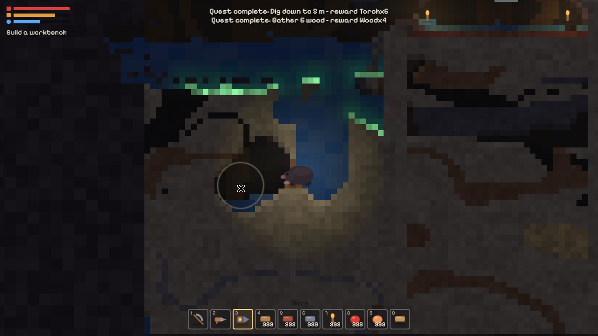

# Player and Controls

> Code: `World::step_player` and `TUNE` in `engine/sim/src/world.rs`; keys in `input` in `engine/game/src/main.rs`; the controls table in `menu::CONTROL_ROWS`.

You play one Delver: a body **1.8 cells wide and 2.9 tall** (about 45 × 73 cm) moving through a world of 25 cm cells. The movement is pure sim code, so every feel change can be tested headless (see [Testing](Testing.md)).

## Controls

| input | action |
|---|---|
| `A` / `D` | Run. Instant start and stop. Steps of 1–2 cells are climbed at full speed, and you shove through loose sand |
| `Space` (or `W` off a wall) | Jump. Hold for a full jump, tap for a short hop |
| Into a wall in the air | Cling. `W` / `S` climb up or down; let go and you slide slowly. `Space` wall-jumps away; at the top you mantle the ledge |
| `W` / `Space` in water | Swim up |
| `S` | Dig down (on the ground) |
| Left mouse | Use the item in hand: dig, place a block brush, torch, copperline, device, spore, TNT or station |
| Right mouse | Interact: flip a lever, step a thrum pattern or ticker beat, light TNT or a fuse cord |
| `Ctrl` + right mouse | Pick up copperline or a device (a lit charge is defused) |
| `[` / `]`, `Ctrl` + wheel | Brush size for the tool or block in hand, within its range |
| `1`–`0`, wheel | Hotbar slot |
| `I` | Pack (inventory grid): click a slot to pick it up, click another to drop or swap. The bottom row is the hotbar |
| `+` / `-`, `Shift` + wheel | Zoom (clamped to scale 0.12–0.75 and saved) |
| `H` | Controls overlay |
| `Esc` | Pause menu, or close a panel |
| `K` / `L` | Quick save / quick load |
| `F3` | Developer info |

Menus pause the sim. A key or mouse button held while a menu closes is ignored until released, so the click or `Space` that started the game never digs or jumps.

## The feel target

Movement should feel like **Streets of Rogue**: instant start and stop, no input latency, and every action firing on press with immediate feedback. In practice:

* Running reaches top speed in under 8 ticks and stops almost at once (ground acceleration 900, deceleration 1400 cells/s²).
* Reversing in mid-air takes about 4 ticks. Letting go in the air **coasts** (only 60 cells/s² of drag), so wall-jump and run-off momentum carry.
* **Coyote time** and a **jump buffer** of 0.1 s each: a jump 4 ticks after leaving a ledge works; 12 ticks after, it doesn't.
* Releasing jump early triples gravity (`cut_mul`) for a short hop. Falling uses 1.7× gravity, so arcs are snappy rather than floaty.
* **Corner correction** (`nudge` 0.6 cells): rising into a corner slides the head round it, and moving sideways in the air snaps the feet to the nearest row so you slot into tunnel mouths. Jumping into a 2-wide shaft half a cell off-centre still goes up.
* Feedback is immediate: the mining strike sounds on the first tick of a press and every 1/6 s after; a cleared bite or placed block pops on screen; any knock of more than 0.5 hp flashes the mole for 0.22 s and jolts the view in proportion; hard landings (8+ cells) thump the camera and squash the sprite.

## `TUNE`

Every movement constant lives in one place, `TUNE` in `world.rs`. Units are cells and seconds, with +y down.

| constant | value | meaning |
|---|---|---|
| `run` | 15 | top run speed (cells/s, about 3.75 m/s) |
| `ground_accel` / `ground_decel` | 900 / 1400 | speeding up / braking on the ground |
| `air_accel` / `air_decel` | 480 / 60 | steering / drag in the air |
| `gravity`, `fall_mul`, `cut_mul` | 150, 1.7, 3.0 | gravity; extra on the way down; extra after releasing jump |
| `jump_v` | 42 | take-off speed (a full jump rises about 6 cells) |
| `terminal` | 60 | maximum fall speed |
| `coyote`, `buffer` | 0.1, 0.1 | grace windows (s) |
| `climb`, `slide` | 10.5, 3 | wall climb speed; slow slide when clinging without input |
| `wall_jump_x`, `wall_jump_y`, `wall_lock` | 17, 36, 0.13 | wall-jump kick and how long steering is locked after it |
| `step`, `mantle` | 2, 3 | cells climbed automatically on the ground / over a ledge |
| `nudge` | 0.6 | corner-correction reach |
| `swim_mul`, `swim_grav`, `buoyancy`, `swim_up`, `swim_max` | 0.55, 0.35, 40, 70, 11 | water |
| `lava_mul`, `lava_sink`, `lava_up`, `lava_dps` | 0.25, 3, 22, 75 | lava |
| `safe_fall` | 20 | cells you can fall without harm |

Change `TUNE`, then rerun the tests and scenarios. The feel scenarios (`run_jump`, `coyote`, `coyote_late`, `air_turn`, `wall_jump`, `wall_climb`, `mantle`, `step_up`, `shaft_jump`, `tunnel_mouth`) assert the numbers that matter: rise, `vx` after N ticks, and the coyote window.

## Water and lava

* **Water** slows you to 55 %, mostly cancels gravity, and lets you swim up with `W` or `Space`. Your breath runs down while you're under; when it runs out you lose health.
* **Lava** is thick: you sink into it at 3 cells/s, wade at a quarter speed, can barely claw up, can't cling to walls, and burn at 75 hp/s.

## Vitals and death

The mole has **health**, **food** and **breath**, shown as the three bars in the top-left corner.

* **Falls:** each cell beyond 20 costs 3 hp.
* **Hunger** drains over time. Below 40 the mole eats from the pack on its own: a grub restores 45, a mushroom 35 and fungus 25. Starving hurts.
* **Breath** drains in stale air (CO2 above 0.45), underwater and when buried by falling rock or sand. If there's room, a buried mole wriggles up.
* **Death:** after 2.5 s you respawn in the burrow with full health and breath (the window slides back to it if needed). The death count is kept in saves.

## Digging and reach

You can act on cells within **18 cells (4.5 m)** of the mole. A dig tool carves a **round bite** under the cursor. A cell takes `dig × 4 / (1 + tier) + 1` ticks (never fewer than 4), and the tool's tier must reach the material's tier. If you aim level with the body (or straight up or down), the bite also clears a body-sized passage to the aim point (at most 6 extra cells, and only cells the tool can dig), so pointing ahead always tunnels through. Tools and the brush are on [Tools and Items](Tools-and-Items.md).
