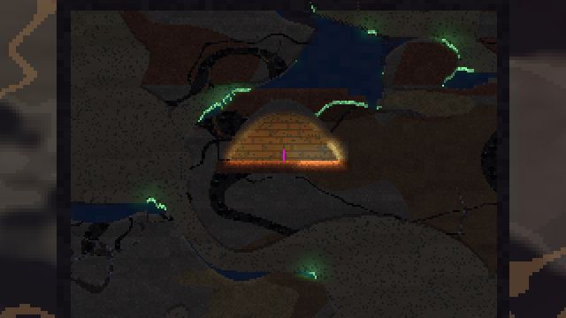

# Molehill wiki

This folder is the Molehill wiki: plain markdown pages that link to each other and are read straight on GitHub. Start here.

Molehill is a falling-sand platformer and colony sim about moles digging through the **Deepholt**, an endless body of earth with no sky and no surface. You play one Delver. You run, cling and wall-jump through tunnels you carve yourself. Every cell of sand, water and lava moves, and every roof you leave behind has to carry its own weight.



## What makes it Molehill

* **The ground is the game.** About two million 12.5 cm cells are simulated at 60 ticks a second. Sand pours, water levels out, lava creeps, and stone cracks when a span gets too wide. Even loose things obey it: a dropped stone bounces off granite and dies in dirt, wood floats, and a thrown charge rolls before it goes off.
* **Structures are judged by real numbers.** Roofs are checked as beams in bending and pillars in compression, using densities and rock-mass strengths in kPa. A 1 m dirt span holds; a 6 m one comes down. See [Physics](Physics.md).
* **Movement is snappy.** Instant start and stop, coyote time, a jump buffer, wall clinging and corner correction. The target feel is Streets of Rogue: actions fire on press with immediate feedback. See [Player and Controls](Player-and-Controls.md).
* **Handmade technology.** Copperline carries current from levers, heatstones and water wheels through knots into doors, lamps, pumps and blasting charges. Signals cross solid rock by thrumming. See [Devices and Copperline](Devices-and-Copperline.md).
* **No sky, ever.** The world keeps going up and down for as long as you dig. What you leave behind stays: rows that scroll out of the live window are kept in 8 m bands, devices and all, and saved band by band. See [Lore](Lore.md) and [World and Generation](World-and-Generation.md).

## Pages

| page | what it covers |
|---|---|
| [Lore](Lore.md) | The fixed principles every feature must follow |
| [World and Generation](World-and-Generation.md) | The endless window, strata, biomes, caves, fluid pockets, ore, the start burrow |
| [Physics](Physics.md) | Materials, falling sand, liquids and lava, structure and stability, light, stale air, thrumming |
| [Player and Controls](Player-and-Controls.md) | Keys, the movement model, `TUNE`, vitals and death |
| [Tools and Items](Tools-and-Items.md) | Dig tools, the round brush, blocks, the pack, stations, recipes and quests |
| [Devices and Copperline](Devices-and-Copperline.md) | Nets, sources, knots, sinks, TNT and fuses, heatstones, wheels, thrummers |
| [Testing](Testing.md) | The headless test suite and the `.scn` scenario harness |
| [Progression](Progression.md) | *Mostly design* (Survival and Creative modes are in): depth as progression, the survival loop, tiers, crafting, furnishing, transportation, grottos, modes, the Ancients |
| [Architecture](Architecture.md) | Crates, the sim/engine split, the frame loop, native and web builds |

## Play it

Molehill is private and has no hosted build. From a clone:

```bash
cd engine && cargo run --release              # native; add `-- --fresh` to skip the autosave
python3 -m http.server -d site 8080           # web: the committed wasm build, then open localhost:8080
```

New Holt asks for **Survival** (a small kit; you dig with the tools you own, find food and burn fungus oil for light, and your pack stays where you fall) or **Creative** (every item, nothing hurts).

## Keeping this wiki true

The wiki lives only here, in `docs/wiki/` on `main`. Any merge to `main` that changes behaviour (rules, numbers, controls, devices or the build) must update the matching page in the same change ([`AGENTS.md`](../../AGENTS.md) says so too). [`LORE.md`](../../LORE.md) is binding: if the [Lore](Lore.md) page and `LORE.md` ever disagree, `LORE.md` wins and the page is fixed. Use at most a few screenshots, stored in `images/`.
