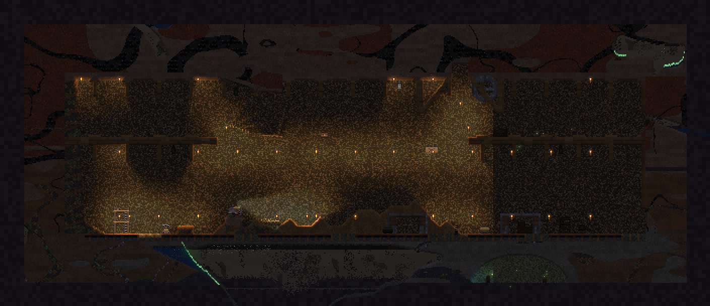
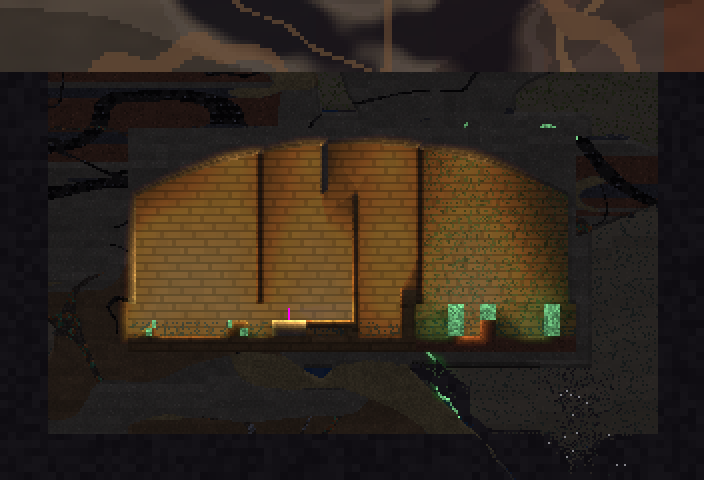
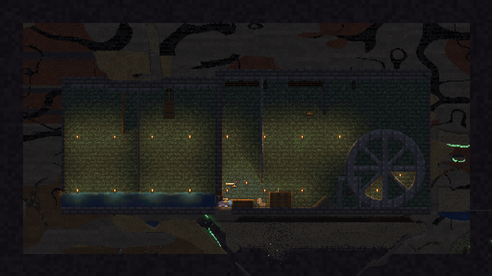
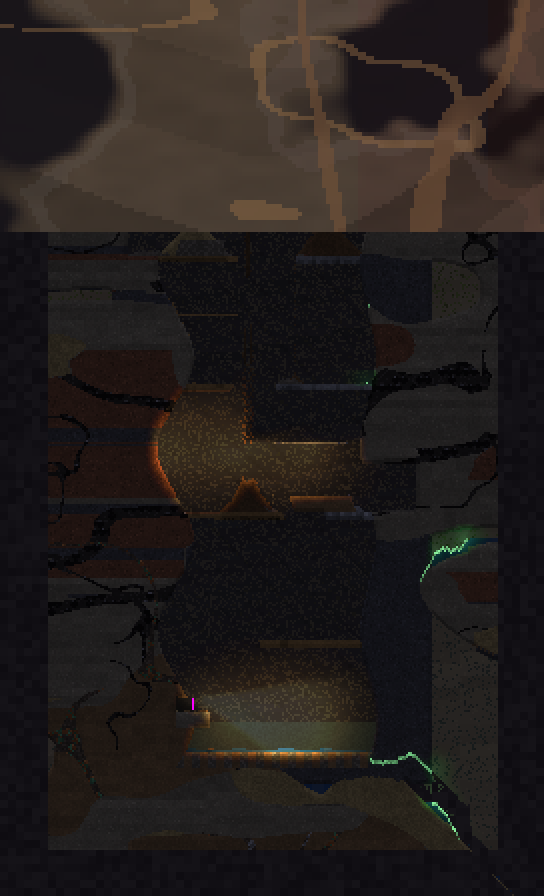
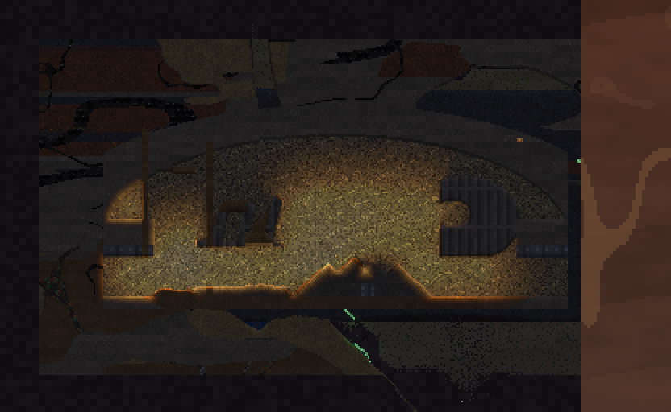
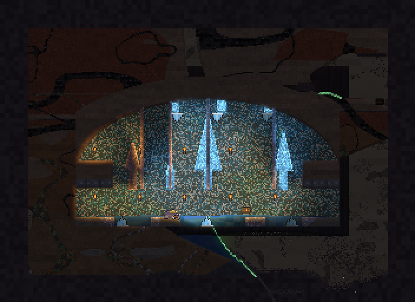
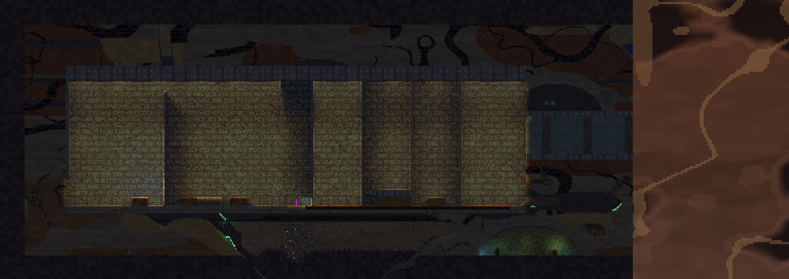

# World and Generation

> Code: `engine/sim/src/gen.rs` (procgen), `walls.rs` (background lining), `sites.rs` (found places), `World::shift` and `follow_colony` in `world.rs` (the endless window), `disasters.rs`.

## The shape of the Deepholt

The Deepholt has no top and no bottom, so the game never holds "the world" in memory. It holds a **window**: a grid of **2048 × 1024 cells**. One cell is **0.125 m** (`mat::CPM` = 8 per metre), so the window is 256 m wide and 128 m tall. Depth 0 is the layer you start in. Positive depth is deeper and negative is shallower, and both run on forever.

```
          … generated on demand …
   ┌──────────────────────────────┐  ← window row 0 = absolute row `oy`
   │ bedrock │  2048 × 1024   │ bedrock │
   │  wall   │  live cells     │  wall   │   the sim, stress, light and air run only here
   └──────────────────────────────┘
          … stored bands / not yet generated …
```

* **Vertically endless.** When the camera or colony gets near the top or bottom edge, the window **slides by 32 m** (`SLIDE` = 32 × CPM rows). The margin is `min(25 m, (h − SLIDE) / 2)`, so small test windows don't thrash. Rows that leave are packed into 64-row **bands** (`band.rs`) with everything in them: cells, copperline and devices (a lit fuse keeps its time), air, torches, drops, stations and mushroom plots. So your tunnels and builds are still there when you come back. Until format 4, only the cells were kept and builds vanished. Rows that have never been seen come from the **stream** (`stream.rs`): each fresh band is generated with 16 m of rock above it and 8 m below, shored up against that (`gen::Stab`, in 32 m wide tiles), and kept until the window gets there. Bands are built ahead, 3 slides (96 m) above and below the window, on a worker thread natively and a few-ms slice per frame on the web (`World::prefetch_step`); the loading line builds them before play starts. A slide just copies them in. The structural state slides with the rock (`Stress::shift_rows`). The entering rows plus 16 m of the old ones (the **seam**) and the edge the window left are re-solved over the next ticks, one 32 m box a tick, after one pass that finds which rock still has a load path. At the seam, what fails is put right as the generator does it: rock left hanging is cleared, and an overloaded cell turns to limestone or granite, with the voids round it filled if it still fails. The regular stress pass waits for the seam (about 20 ticks). Only the entering chunks wake. On the game window a slide costs about 20–40 ms of CPU, down from 0.4–1.3 s when the fresh rows were generated and shored in the slide itself (`--example digbench`; `slide_keeps_stress_state` checks the result matches a full solve).
* **Horizontally bounded.** The two outermost columns on each side are bedrock.
* **Deterministic.** Every generated cell is a pure function of `(seed, x, absolute row)`. The same seed always gives the same Deepholt, wherever you start looking. A fresh band is shored up from the seed alone too, so it comes out the same whatever route reaches it, and whether it was built ahead, on the thread or at the slide (`tests/stream.rs`). The first window is stabilised as a whole (see below).
* **Chests** come 6 per 32 m band (`CHEST_BAND`), each on a cave floor, chosen by hashing `(k, band, seed)`. Opened chests are remembered by absolute position across slides.

## Effective depth

Generation works on an **effective depth** `dd` rather than the raw depth, so layer boundaries wander:

```
dd = depth_m + (fbm noise − 0.5) × 10 m + biome offset
```

The biome offset is −4 m for Loamlands, +2 m for Karst caverns, +8 m for Granite crags and +4 m for the Ashlands. A crag column is "deeper" than its depth suggests, so hard rock rises closer to the start there.

## Biomes

Biomes vary along x only (a 2-octave fbm at scale 65 m). Generation noise is sampled in 0.25 m tiles, so every feature keeps its size in metres at any resolution. so each one is a tall column you can dig straight down through.

| biome | share of noise | character |
|---|---|---|
| Loamlands | < 0.36 | Soft and shallow-feeling: more dirt and clay, ordinary caves |
| Karst caverns | 0.36–0.52 | More and larger caverns (cave threshold +0.04) |
| Granite crags | 0.52–0.66 | Granite from depth 0; fewer caves (−0.03) |
| Ashlands | ≥ 0.66 | Basalt below 70 m everywhere; hot and deep-feeling |

## Strata

| effective depth | rock |
|---|---|
| above −30 m | dirt, with clay lenses |
| −30 to 0 m | dirt, clay and limestone patches |
| 0 to 30 m | limestone and soft rock (granite in the crags) |
| 30 to 70 m | granite and soft rock |
| below 70 m | mostly basalt, some granite (all basalt in the Ashlands) |

Above 35 m, lenses of **sand** and **gravel** form in the rock where the lens noise is above 0.67 (`gen::LENS`; 0.012 more in the upper layers, above 10 m effective depth). The wettest (0.04 over that) are aquifer-saturated (`F_WET`): they seep water when you dig into them, and they make a mushroom farm damp.

**Settled ground round the burrow** (`gen::SETTLED`, `settled_at`): within 40 m of the burrow, easing off by 70 m, the lens threshold is up to 0.14 higher, so lenses there are rare and small. None of them are soaked, and sand within 1 m of a natural cave is cemented into sandstone. A new holt's first tunnels then don't run into a steady rain of loose ground, while further out and deeper (10–35 m) the lenses are as common as ever. Measured over 16 seeds (`--example loosesurvey`), within 30 m of the burrow the loose share (sand, gravel, fungus, knocked-loose ground) went from 7.5 % to 0.7 % of the ground, and the soaked share from 7.7 % to 0.2 % (the near grotto's moss and roots). Tests: `loose_lenses_are_rare_round_the_burrow_but_not_beyond`, `a_new_holt_starts_on_settled_ground` (`sim/tests/settled_ground.rs`).

**Ore veins** follow thin ridged-noise bands, and each ore sits in a **depth band** that matches the progression tiers (see [Progression](Progression.md#tiers)). Inside its band a seam is at full strength; over the fade it thins out to nothing (`gen::Band`):

| ore | tier | full strength (effective depth) | fades out over |
|---|---|---|---|
| coal | 1 | −20 to 9 m (thin seams up to −60 m); never where lava runs | – |
| copper ore | 2 | 2 to 30 m: just below the holt | 10 m |
| tin ore | 2 | 12 to 45 m | 8 m |
| iron ore | 3 | 40 to 85 m, in the granite (none above about 30 m) | 8 m |
| quartz | – | below 50 m | 10 m |

Copper ore's base colour is a bright copper-orange (`mat.rs`, used wherever a cell's plain colour shows: dust, debris, the minimap), well apart from the browns of dirt and clay; on screen it is drawn as green-flecked nuggets (`art::mat_color`). Rail's base colour is a dark strap rather than a wood brown, and it is drawn as a copper strap.

Deep down (below 70 m) the rock is mostly **basalt**, with crystal and quartz on the cave walls and lava in the pockets: the heat layer of tier 5. All of it comes from seeded noise, so it's the same for a seed every time (`ore_sits_in_its_depth_bands`).

**Cave walls** are decorated: **crystal** (which glows) below 45 m, **quartz** below 35 m, **glowing fungus** on cave floors above 9 m, and **roots** above −10 m.

## Grottos

**Grottos** are rare underground oases where water seeps through the rock (see [Lore](Lore.md#grottos)). They're the Deepholt's wood source.

* **Where:** the world is cut into 40 m × 24 m grotto cells, and a seeded hash decides whether each one holds a grotto. The chance follows the water: 20 % in the wet upper layers (above −20 m), falling to 10 % at 10 m and 2 % by 50 m, and none below 60 m, where lava takes over. A grotto may open up within sight of the start burrow, but its box (shell included) always stays 2 m clear of the burrow's footprint (about 6 m to each side, 5 m up and 3 m down), so it never breaks in (`grottos_near_spawn_never_touch_the_burrow`). **A grotto near the start:** in a window wide enough for found places (the 256 m playable one), every holt has a grotto with two or more root-trees within 30 m of the burrow, so the first wood is a fair dig away, not a wiki hunt. If the seed already grew one that close it is that one; otherwise `Gen` places one (same shape rules, two trees) in an empty grotto cell beside the start, 14–30 m from the burrow and no more than 14 m above or below it (`gen::NEAR_GROTTO`, `a_grotto_with_trees_is_within_reach_of_every_new_holt`). It never replaces a grotto the seed grew and gives no more wood than any other grotto. Over seeds 1–20 the nearest grotto with trees is 18–30 m from the mole, and 11–43 wood lies within 40 m (`survey`). Seed 14085 shows one: a root-tree about 12.5 m right of the spawn and 5 m up, on screen at default zoom (the `grottoseed` example finds such seeds). A window usually holds a few (`grottos_follow_the_layers`).
* **Shape:** a domed hollow 10–16 m wide and 4.5–7 m high with a flat floor. Around it lies a 1.5 m **shell** that is limestone wherever the host rock is too weak to hold a dome, so grottos stand (`generated_grottos_hold`).
* **Inside:**
  * **Moss** and glowing **mycelium** carpet the floor (both soil a mushroom grows on), and mycelium threads the lower walls.
  * A **seep pool** is sunk into the floor.
  * There are 1–3 **root-trees**: 0.5 m trunks, 2–3.5 m tall, standing on spreading **root-tree roots**.
* **Root-trees regrow.** Cut a trunk and it gives **wood**. While its roots stand and there's seep water within about 6 m, the trunk grows back a cell at a time, about every 6 s per column, to its old height. Dig out the roots, or drain the pool, and it never comes back. The rule reads only the grid, so it survives slides and saves (`tree_regrow`, `tree_no_seep`).
* **Glowmites** drift through every grotto: a swarm of 4–7 small, cold green-gold lights, each on its own slow loop round the hollow. Each one is a light source. Right mouse on one catches it in a jar (a **Glowmite** in the pack, which glows when held). A grotto's swarm refills, with a caught glowmite replaced after 5 minutes (`glowmite_catch`, `glowmites_drift_glow_and_get_caught`).
* **Discovery:** the first time you come within 8 m of a grotto's hollow, a line goes in the log, like ruins and found places: "A grotto, 22 m down: water seeps through the rock here, root-trees drink it, and glowmites drift in the hollow. Cut root-trees for wood." ("6 m up" or "level with the burrow" for one above or beside it). Once per grotto; saves remember which (format 11). No cards (scenario `grotto_discovery`).
* Grottos are a pure function of the seed and position like the rest of the world, so a slide or a reload regenerates them identically.

## Ruins of the Ancients

Rare remains of facilities built by the Ancients (`sim/src/ruins.rs`). The world is cut into 160 m × 80 m ruin cells, and a seeded hash decides whether each holds one: none above 15 m, then 5 % rising to 25 % by 60 m and below, so about 3 per kilometre of depth across the window. None comes near the start burrow, and none overlaps a grotto (`ruins_are_rare_deep_and_clear_of_the_start_and_grottos`). Three kinds, in equal numbers:

* **Pumping hall** (28 × 11 m): brick walls and floor, a 1.5 m brick roof on four iron pillars, iron pump blocks beside a flooded sump. One pillar has given way (a stump in its rubble), and the Ancients slung an iron girder under that bay.
* **Sealed vault** (9 × 6 m): 1.5 m of brick on every side under an iron lintel, no way in but through it, and a chest inside.
* **Tube station** (56 × 8 m): a platform hall and a 2.5 m capsule tube (a quarter-metre iron skin in a metre of brick) running 42 m off into the rock, choked by an old cave-in. Where the tube meets the hall stands a broken **waygate**: an iron frame round a sealed gate. It's the hook for the Ancients' fast lines (see [Progression](Progression.md#ancient-waygates-open-decision)): found, not yet mendable.

Ruins are stamped in whole at generation (their halls and tubes are kept open like grotto hollows) and are then ordinary cells: brick, iron, a door and gravel to the physics. A hall stands as built under an open cave, but under a load of sand its brick bays crack and fall in (`ruin_hall_stands`, `ruin_hall_caves_in`). Inside thick rock the rock arch carries everything, so a buried ruin only comes down if something opens above it or loads it.

The first time you come within 8 m of a ruin, its **carving** is read out: one of eight short fragments (Delvers digging upward, a band left blank above the layers, a tally of fast lines), and at a tube station a note on its waygate. A **vault's chest** holds old materials (iron ingots, copperline, crystal) and the next unfound **relic**: the **Ancient bit** (carried, every bite digs a quarter faster), then the **Ground lens** (carried, the headlamp burns half the oil). Each relic turns up once; the save keeps the relics found and the ruins visited (`ruin_vault_loot`). `ruinsurvey` counts ruins over seeds and dumps one from a generated world.

## Background walls

A **background wall** is a Terraria-style lining behind the player and the falling sand (`sim/src/walls.rs`). It is **not** a material: it never enters the CA, the stress solver or collision. You walk in front of it. It holds up nothing. It exists so a dug room reads as carved rock or a timbered holt instead of a hole in the far parallax.

* **Storage:** one byte per window cell, packed as an optional trailing RLE on each band (save format 10). Older saves load and then `infer_back`: open cave is lined the way a fresh holt would be, and the start burrow is timbered.
* **Look:** darker and flatter than a real block under the same light (`WALL_K` = 0.78, floor `WALL_AMIN` = 0.34 so a lined room in the dark is still timber or rock, not a hole). Found places also use five linings of their own that no pack item makes: soot, wet stone, basalt, ashlar and ironclad. Damp stains, cracks, roots and missing panels let a little of the far rock through. Crystal lining does not glow; crystal *blocks* still do.
* **Lining a bite:** digging a solid cell that has no lining leaves one that matches what you cut (rock, timber, masonry, pipes).
* **Placing and scraping:** with a wall item in hand, left mouse panels the back (hold; `X` snaps a line). Right mouse scrapes lining back into the pack. Neither edits the rock in front. Shift is sprint, never a wall modifier. Bedrock cannot be panelled.
* **Creative** has 999 of every wall; **Survival** crafts them at the workbench (rock, timber, carved, beams) or the forge (masonry, pipes).
* Headless tests do not prove the contrast looks right in the game (`back_walls_line_place_scrape_and_save`, `wall_place_scrape`, `wall_saveload`, `wall_no_support`, `wall_walk`).

## Found places

Seven families of **found places**, not random loot rooms (`sim/src/sites.rs`; what each box holds is stamped from a data template in `assets/sites/`, see [Site templates](Site-Templates.md)). Each has a purpose, materials, layout variation, a depth band, and something a Delver can do. Foreground (props, rails, water, tubes) is ordinary cells and obeys the same physics as anything you build. Background lining comes from the wall layer and holds no roof. They **never** grow a second Ancient waygate: a buried cargo halt sits next to an existing tube station when one is near, and faces it.

* **Where:** the world is cut into 96 m × 48 m site cells. A seeded hash decides whether each holds a site (about 10 % in the holt layers, a little more through the mid-granite, none in the far wet up or the lava deep). None comes near the start burrow, none overlaps a grotto, a ruin, or another site. Small test windows (under 160 m wide: the arena and most scenarios) stay site-free so existing holts don't change shape. The playable window (256 m) gets them. Deterministic, rare, clear of the start: `sites_are_rare_deterministic_and_clear_of_start_ruins_and_each_other`. **A first-hour find:** every playable holt also has a found place with a chest a real trek from the burrow: its nearest cell 35–90 m away and inside the starting window (`sites::NEAR_FIND`). If the seed placed one there it is that one; otherwise an abandoned mine (else an abandoned holt) goes into an empty site cell by the same rules as any site, clear of the start, grottos and ruins, never replacing a site the seed placed (`a_rewarding_find_is_a_first_hour_trek_from_the_burrow`). Survey seeds 1–50 (after the found-place rework): 50 of 50 have one, at 40–86 m; 39 are mines, 8 holts, and one each a cargo halt, pumpworks and fossil cave. A mine's timber sets (post and cap) stand every 4 m (`sites::MINE_BAY`), so no stretch of its 1 m roof spans further: at 8 m a mine under weak host rock couldn't stand (`slides_leave_nothing_failing`, seed 11).
* **Discovery:** the first time you come within 8 m, a line goes in the log. No cards, no banners.
* **Chests** hold old kit from what the place was for (rails, clay, quartz). Relics stay in Ancient vaults.

| family | size | depth | what it is | what you do |
|---|---|---|---|---|
| Abandoned mine | 72 × 22 m | 0–56 m | a two-level sooty mine: haulage track on sleepers in ballast, an upper heading, a shaft house with a tall timber headframe and iron winch, ore chutes, short timber sets every four metres (not a colonnade), a worked face and spill, collapsed timbering, two adits | mine the face; climb the shaft; salvage rails and timber (`abandoned_mine_track_and_ore_face_read`) |
| Abandoned holt | 28 × 14 m | −32–20 m | a domed timber holt (host rock above the dome, not a box): nesting alcove, kitchen hearth and chimney, hall with table, loft storage and dressed walls, fungus garden, two doors | read the rooms; the farms still grow |
| Flooded pumpworks | 48 × 20 m | −12–40 m | wet-stone pumpworks: canal and flooded intake, a closed sluice, pipes hung from the roof, a 10 m iron pump wheel sitting on the floor (no colonnade of pillars), a timber landing on the viewing window's sill with a rope down to the dry hall (the way over the wheel from the service door to the chest, unhurt), crate stacks in the dry hall, a service door | flip the lever or dig the plug; water is real; over the wheel takes the rope gun (on purpose). |
| Fissure | 18 × 40 m | 8–90 m | a tall basalt chasm that widens mid-drop, broken wood and iron bridges (each half one material, keyed into its wall, so they stand; the east mouth opens level onto the 24 m bridge), timber cords hanging under the bridges, rubble on the ledges, mouths on both sides | climb; bring more rope or a lift |
| Fossil cave | 36 × 16 m | 20–88 m | an oval dig (limestone shell, not a filled box) around a beast lying on its floor: spine, ribs and limbs bedded in a mound of the rock that grew round them (each rib standing just proud of it), the skull resting against the east wall over the way in, a rope off the mound's west end down to the chest, walkable iron-lintelled mouths; nothing hangs, so nothing comes down | climb over the ribs; excavate the carved bone; up the mound's 2.2 m east face takes the rope gun (on purpose). |
| Salt / crystal hall | 28 × 16 m | 36–100 m | a salt cathedral (shell, not a box): towering crystal and quartz spires, hanging clusters, three glow-pools, walkable iron-lintelled mouths | harvest; crystal glows, the lining does not |
| Buried cargo halt | 80 × 18 m | 12–84 m | a chunk-scale halt: vaulted iron hall on rails, a derelict railcar with cabin and stack, hanging sign and waiting benches, a pressure tube off one side, a lower-roofed warehouse of crates off the other | ride or strip the cart; the tubes point at an Ancient station when one is near; over its 4.25 m crate stacks takes the rope gun (on purpose). |

Stamped sites and their interactions: `all_seven_site_families_stamp_with_purpose`, `found_places_have_open_silhouettes_not_filled_boxes` (host rock above a holt dome, a pump roof and a halt warehouse, and outside a fossil or crystal shell), `found_places_entrances_reach_every_room_and_the_chest` (from every way in, a mole body can reach the chest — or the fissure floor — and no room of 4 m² or more is cut off; salt-hall and fossil mouths keep their lintels), `site_pumpworks`, `site_mine`, `site_holt`, `site_fissure`, `site_fossil`, `site_crystal`, `site_halt`. Headless tests do not prove the rooms *look* like carved rock. Native `--scene=mine` (and the other family names, or `walls`) stamps one isolated copy in host rock next to the burrow so a `--shot` can inspect lining, props and layout.

**Furnishings.** Each family is furnished with drawn props on top of the set-pieces its layout builds in cells: a winch, scaffolding and dig tools in the mine, pipes and a sluice gate in the pumpworks, broken bridge stubs and ropes in a fissure, crystal clusters in the salt hall, a railcar, bench and station sign in a halt, and a kitchen, bedroll and hanging pantry in a holt. They have no weight and can't be dug. Each is fitted against the cells actually there, so it stands on a floor or hangs from a roof. The full list and the rules are on [Item and Place Art](Item-and-Place-Art.md#found-place-furnishings).

**How they read.** Rail and ore draw their own pixel art (`art::mat_color`): track is a copper strap along the top (old track flecked with verdigris) over dark timber sleepers every half metre with sooty ballast between, so it never reads as a plank floor; ore pockets and veins show rounded half-metre nuggets in the ore's own colour (copper flecked green with verdigris, rust-red iron, pale tin, glossy coal) in a darker matrix. Nothing glows: they are lit like any rock (tests `rails_do_not_read_as_a_wood_floor`, `ore_pockets_stand_out_without_glowing`).

### What they look like

One still of each family, stamped with `--scene=<family>` on seed 4242 and lit by the scene's torches. These are the CPU-side composite from `--dump-art` (`view.bmp`), cropped to the site. It now carries the world sprites too (furniture, furnishings, chests, torches, carts, the mole), and the whole crop is rendered, not just the part on screen.


*Abandoned mine* (`--scene=mine`)


*Abandoned holt* (`--scene=holt`)


*Flooded pumpworks* (`--scene=pump`)


*Fissure* (`--scene=fissure`)


*Fossil cave* (`--scene=fossil`)


*Salt / crystal hall* (`--scene=crystal`)


*Buried cargo halt* (`--scene=halt`)

## Caves

A cell is open when either test passes:

* **caverns:** a 3-octave fbm (scale 46, stretched 1.6× vertically) plus the biome band is above 0.66: big blobby halls;
* **worm tunnels:** a ridged fbm at scale 110 is within 0.012 of its midline: thin winding passages that link the halls.

## Fluid pockets: wetter up, hotter down

Open cells inside a separate pocket-noise field (`> 0.63`) are filled with fluid. Each 6 m × 6 m patch picks **one** fluid with a hash, so a pocket never mixes:

```
lava share  = clamp((dd − 10) / 60, 0, 0.92)
water share = clamp((40 − dd) / 60, 0.08, 1) of what is left
```

At the start layer pockets are almost all water. By 40 m half of them are lava, and from 70 m on lava dominates. A little water survives at every depth. This is the lore's "cooler and wetter up, hotter and drier down" written as two clamps.

## The start burrow

**The start zone.** Within 25 m of the burrow (`gen::START_SAFE`) every cell can be dug with the Survival Pickaxe (tier 1): whatever the depth bands put there, granite, quartz and crystal become limestone, basalt becomes rock, and iron ore becomes tin ore, and the stability pass props roofs there with limestone instead of granite. Fluid pockets within 35 m are water, never lava (lava would crust into basalt). Crags make granite only from about 15 m down the depth band, not at the top. A new holt therefore always has a way out, and the Pickaxe can always dig through to copper (`spawn_zone_is_pickaxe_ground_with_a_way_to_copper`, over 30 seeds).

The holt begins in a **domed chamber about 7.75 m wide**, carved at depth 0 in the middle of the window:

* the roof is limestone and steps down toward the walls (a parabola, 3 m of drop), so no roof run is long enough to fail in bending;
* side walls tie the dome to a clay floor, and if a cavern lies underneath, limestone legs drop down to the next solid ground;
* water and lava near the burrow are dried to clay, and so is any pocket in the dig-down column 6 m under its floor, 3 m either side (`gen::DRY_UNDER`): a held S doesn't drain a pocket into the shaft and drop the Delver down it (`digging_straight_down_never_kills`, seed 6). Nothing that flows in during the settling pass stays inside;
* the floor stays soil, so mushrooms can grow there, and nothing just below it is granite, so even claws can dig out;
* a **vent** is placed above the burrow and two torches inside it;
* only the burrow starts out seen: what a mole sees from inside the chamber (rays from three spots stop at the first rock, up to `SPAWN_SIGHT_M` = 6 m) and a 1 m skin of its walls. Everything else (caves, ore, the rock around) stays dark until vision, digging or the headlamp finds it, and only materials in sight count as discovered (`spawn_reveals_only_burrow_neighbourhood`, over five seeds). Before, a 30 × 23.5 m box was marked seen straight through rock.

## The stability pass

Random noise makes caves that real rock could not hold. After filling, the generator runs the full structural solver (see [Physics](Physics.md#structure-and-stability)) in a loop:

1. Solve with a **safety factor** (`thr = 0.45`): fresh caves must survive fluids shifting about later.
2. Cells with no load path (floating islands) are removed.
3. Other failing cells are reinforced: weak cells become limestone in the first passes, then granite, and a cell that keeps failing gets an ever-wider fill of the voids around it (the radius grows every 3 rounds, up to 1 m) to thicken roofs and widen pillars. A fresh slide now needs about 18 rounds instead of 42.
4. After 40 rounds the margin is dropped to 1.0, so the loop only has to make sure nothing actually fails.

Only the first round is a full solve. Every later round re-solves just the regions around the cells the previous round changed (`Stress::solve_cells`), with an 8 m margin at the sides and the roof rows kept between solves. This is exact, because every failing cell is changed. Together with the growing fill, this made a new holt several times faster to generate when it was written. At 8 cells/m, `World::new` on the game window now takes about 4–9 s natively, depending on machine load: fill 0.5 s, the first stability pass 2.4 s, 240 settling steps 2.4 s, and the second pass 1.2 s (`genbench`, `loadbench` measure it).

**Built in steps.** `gen::GenBuild` runs the same generation one slice at a time: 64 rows of fill, the burrow, one stability round (`gen::Stab`), or 2 settling steps per `step`. `world::NewHolt` wraps it with the rest of `World::new`. `World::new` is now just a `NewHolt` run to the end, so both give the same holt byte for byte (`staged_new_holt_matches_and_climbs`). The game runs steps for about 20 ms a frame and shows the stage and its share of the time on a loading line. After it, and after a load, the line keeps calling `World::prefetch_step` until `stream_progress()` is 1, so the ground 3 slides above and below is built before play (`loading_prefetch_finishes_the_ground_ahead`). On the game window a build is about 280 steps, and the longest are stability rounds and the last step that wakes the mole, at about 0.2–0.3 s each natively.

Grotto hollows and pools, ruin halls, and a found-place's carved rooms are kept: the stability pass never fills them in, it only strengthens their shell.

After a slide into fresh rows the pass covers the new rows **plus 32 m of the old rows** next to them, because those may now roof a newly generated cave. A roof that runs right up to the window's edge counts as thick (the rock goes on beyond it), so nothing is left about to fail after a slide (`slides_leave_nothing_failing`).

Then the world runs **240 falling-sand ticks** so loose material and fluids settle, and the pass runs again. A fresh world therefore stands: with no player action the start burrow holds and only a little collapses in the first two minutes (this is tested). Collapses are caused by you, or by fluid fronts you open up.

## Disasters

`disasters.rs` keeps its own random stream, so it never disturbs the world's determinism. It cycles calm → warning → active:

| disaster | where | what happens |
|---|---|---|
| Flood | upper half of the window, preferring water pockets | a spring adds water (0.4 % of the world's cells) |
| Lava surge | bottom 40 %, preferring lava pockets | a spring adds lava (0.2 %) |
| Earthquake | the middle band | loosens soft overhangs near the epicentre (0.15 % budget); stress and falling sand do the rest |

Each one gives a **10 s warning** banner with its depth, lasts **6 s** with camera shake, and is followed by a calm of **90–180 s**. The first comes after about 2.5 minutes.

> **Current build:** the game turns disasters off while the game is being tuned (`make_world` in `game/src/main.rs`), and the pack comes from the mode picked at New Holt (Survival's kit or Creative's 999 of everything). The sim and the tests keep disasters.

## Fog, light and the background

* **Fog of war:** cells stay hidden until a mole sees them (raycasts every few ticks, 7 m radius) or digs next to them.
* **Light** comes only from emitters (lava, crystal, fungus, fire) and lights (torches, lamps, forges, the mole's headlamp, a torch in its paws, the mole's own small glow). Rock casts shadows. See [Physics](Physics.md#light).
* **Parallax:** open cells show three procedural deep-earth layers: far strata with biome tint (factor 0.8), cave silhouettes (0.6) and mineral veins (0.35), rusty near the start and pale quartz or ember deeper down. They follow absolute depth, so they stay continuous when the window slides, and they are drawn as GPU sprites that move smoothly with the camera. A **background wall**, if any, sits in front of that far rock and behind the player: darker, flatter, lit by the same light (see [Background walls](#background-walls)).
